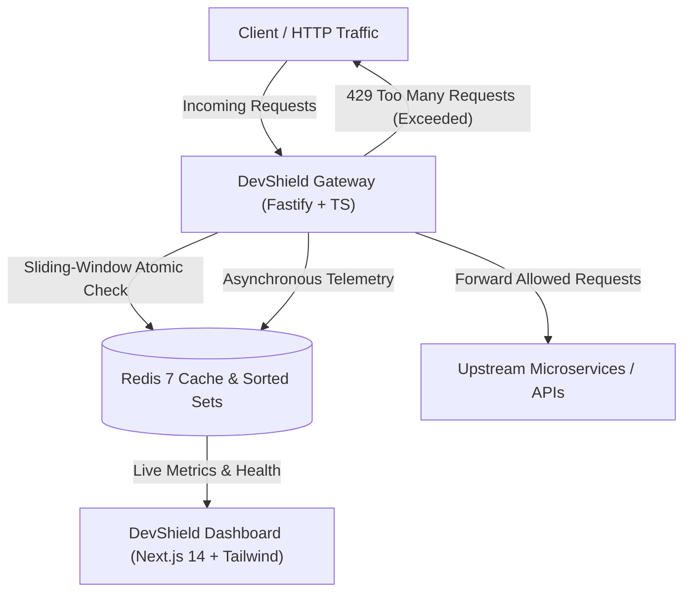

# DevShield: High-Throughput API Gateway & Sliding-Window Rate Limiter

<div align="center">


**A high-performance reverse proxy, atomic sliding-window security engine, and real-time observability console.**

</div>

---

## Architecture Overview



### Core Subsystems:
1. **`/gateway` (Fastify + TypeScript)**:
   - **Sliding-Window Rate Limiter**: Atomic Redis Lua script using sorted sets (`ZREMRANGEBYSCORE`, `ZCARD`, `ZADD`, `PEXPIRE`, `ZRANGE WITHSCORES`) calculating exact retry-after and reset timestamps without race conditions.
   - **Streaming Reverse Proxy**: Dynamic target resolution with prefix matching, path prefix stripping, header hygiene, and request/response streaming.
   - **Standard Rate Limit Headers**: `X-RateLimit-Limit`, `X-RateLimit-Remaining`, `X-RateLimit-Reset`, and `Retry-After`.
   - **Resilient Fallback**: Configurable `fail-open` or `fail-closed` mode when Redis is unreachable.
   - **Non-blocking Telemetry**: Asynchronously streams request counts, status code distributions (`2xx`, `4xx`, `429`, `5xx`), and P95/P99 latency calculations.
   - **Management API**:
     - `GET /health`: Reports gateway uptime and Redis connection status.
     - `GET /api/metrics`: Live metrics and percentile latencies.
     - `GET & POST /api/rules`: Dynamic route and rate-limiting policy management.

2. **`/dashboard` (Next.js 14 App Router + Tailwind CSS)**:
   - **Overview Cards**: Total requests, 429 rate limit hits, active rate limit policies, and P95 latency.
   - **Live Telemetry Chart**: Area chart showing forwarded throughput vs. 429 blocked spikes over time.
   - **Status Code Breakdown**: Color-coded visualization for `2xx` (success), `4xx` (client errors), `429` (rate limited), and `5xx` (server errors).
   - **Interactive Policy Manager**: Dynamic table to view, toggle, and add rate-limiting rules in real time.
   - **Traffic & Burst Simulator**: Built-in test widget allowing users to fire concurrent bursts (5x, 15x, 30x) to test 429 mitigation live.

---

## Directory Structure

```plaintext
DevShield/
├── AGENTS.md                  # Strict TypeScript rules & development guidelines
├── docker-compose.yml         # Local Redis 7 & downstream echo container
├── gateway/                   # Fastify reverse proxy & rate limiter engine
│   ├── src/
│   │   ├── config/            # Env and route rule schemas with Zod
│   │   ├── limiter/           # Redis connection, Lua scripts, sliding-window algorithms
│   │   ├── proxy/             # Reverse proxy dispatcher, router, header sanitization
│   │   ├── analytics/         # Non-blocking telemetry tracker with percentiles
│   │   ├── routes/            # Internal admin endpoints (/health, /metrics, /rules)
│   │   ├── server.ts          # Fastify server composition
│   │   └── index.ts           # Gateway entrypoint & graceful shutdown
│   └── test/                  # E2E integration tests (proxying, 429s, admin APIs)
└── dashboard/                 # Next.js 14 observability console
    └── src/
        ├── app/               # Next.js App Router (layout, page, globals.css)
        ├── components/        # Navbar, OverviewCards, TrafficChart, RulesTable, etc.
        └── lib/               # Gateway API client, traffic simulator, TypeScript types
```

---

## Quickstart

### 1. Start Infrastructure (Redis & Mock Downstream)
```bash
docker compose up -d redis mock-upstream
```

### 2. Start DevShield Gateway
```bash
cd gateway
npm install
npm run dev
```
The Gateway will start on `http://127.0.0.1:8080`.

### 3. Run Gateway Integration Tests
```bash
cd gateway
npm test
```
Executes all 16 end-to-end integration tests:
- Proxy forwarding of GET, POST (JSON payloads), query params, headers, and prefix stripping.
- Rate-limit enforcement, monotonic decrementing of `X-RateLimit-Remaining`, burst rejection yielding `HTTP 429 Too Many Requests` with `Retry-After`.
- Multi-client IP isolation and sliding-window recovery.
- Fail-open / fail-closed resilience.

### 4. Start Dashboard
```bash
cd dashboard
npm install
npm run dev
```
Open [http://localhost:3000](http://localhost:3000) to view the live dashboard console.

---

## Redis Sliding-Window Algorithm (Lua)

DevShield implements an atomic sliding-window algorithm executed inside a single Redis transaction:

```lua
local key = KEYS[1]
local now = tonumber(ARGV[1])
local windowMs = tonumber(ARGV[2])
local maxRequests = tonumber(ARGV[3])
local memberId = ARGV[4]

-- Step 1: Evict timestamps outside the active sliding window
local clearBefore = now - windowMs
redis.call('ZREMRANGEBYSCORE', key, '-inf', clearBefore)

-- Step 2: Count requests remaining in current window
local currentCount = redis.call('ZCARD', key)

if currentCount < maxRequests then
    -- Allowed: record current request timestamp
    redis.call('ZADD', key, now, memberId)
    redis.call('PEXPIRE', key, windowMs)
    local remaining = maxRequests - currentCount - 1
    local resetTimeSeconds = Math.ceil((now + windowMs) / 1000)
    return { 1, remaining, 0, resetTimeSeconds, currentCount + 1 }
else
    -- Blocked: calculate precise Retry-After from oldest entry
    local oldest = redis.call('ZRANGE', key, 0, 0, 'WITHSCORES')
    local oldestScore = tonumber(oldest[2])
    local retryAfterMs = math.max(1, (oldestScore + windowMs) - now)
    return { 0, 0, math.ceil(retryAfterMs / 1000), math.ceil((oldestScore + windowMs) / 1000), currentCount }
end
```
